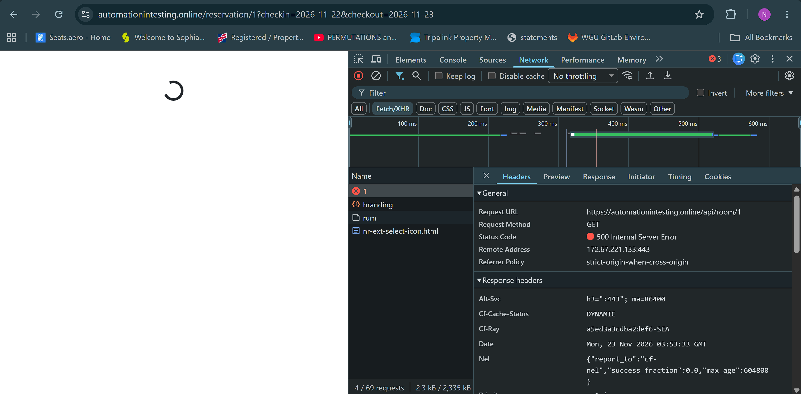
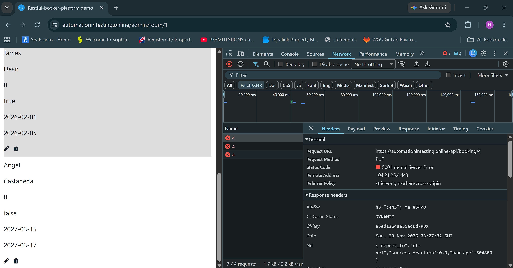

# Reservation Management System QA Portfolio

## Project Overview

This is an independent QA testing project I completed using the Restful Booker Platform, a public hotel reservation practice application.

I created this project to gain hands-on experience with the QA testing process, including understanding requirements, designing test cases, executing tests, investigating defects, and documenting results.

I used manual testing, Postman for API testing, and Playwright with JavaScript for browser automation.

**Application:** https://automationintesting.online/

## My Testing Approach

I started by exploring the application to understand how the room listings, reservation process, and administrator features worked.

Since this was an independent project, I developed my own proposed functional requirements and acceptance criteria. I then used those criteria and the application's API documentation to create test scenarios and test cases.

My work included:

1. Developing requirements, acceptance criteria, and 15 test cases.
2. Executing manual tests for room browsing and reservation functionality.
3. Testing eight API requests using Postman and writing JavaScript assertions to validate responses.
4. Automating three browser tests using Playwright.
5. Using Postman's Collection Runner to execute multiple API requests automatically.
6. Investigating unexpected behavior with Chrome DevTools and Postman.
7. Documenting four issues with reproduction steps, test evidence, and screenshots.
8. Configuring GitHub Actions to run my Playwright tests automatically.

## Testing Results

| Test Type | Test Cases | Passed | Failed |
|---|---:|---:|---:|
| Manual Testing | 4 | 3 | 1 |
| Postman API Testing | 8 | 5 | 3 |
| Playwright Automation | 3 | 3 | 0 |
| **Total** | **15** | **11** | **4** |

## Manual Testing

I created and executed four manual test cases covering booking navigation, room categories, Book Now buttons, and the Single room reservation interface.

Three tests passed. One failed because the reservation interface remained stuck on a loading screen.

I also noticed a minor navigation issue where clicking Booking reached the correct section but did not position all the content clearly on the screen.

[View Booking Navigation Screenshot](screenshots/TC-001-booking-navigation.png)

### Reservation Page Loading Issue

When I clicked Book Now, the reservation page did not finish loading.



I investigated the issue through Chrome DevTools and then tested the room detail API independently in Postman, where the request also returned HTTP 500.

[View Postman HTTP 500 Screenshot](screenshots/TC-004-postman-api-500.png)

[View Manual Test Execution Results](manual-testing/test-execution.md)

## API Testing with Postman

I used Postman to test eight API requests covering administrator authentication, room retrieval, reservation creation, individual booking retrieval, updating, and deletion.

I also wrote JavaScript assertions to check HTTP status codes and response data. I used collection variables to store the authentication token and booking ID returned by requests.

Five API tests produced the expected results. Three requests returned HTTP 500 when attempting to retrieve, update, or delete an individual reservation.

### Postman Collection Runner

I used Postman's Collection Runner to automatically execute four selected API requests in sequence:

1. POST Admin Login
2. GET All Rooms
3. GET Bookings by Room
4. POST Create Booking

**Result: 10 assertions passed, 0 failed.**

The three requests that previously returned HTTP 500 were excluded from this passing run and investigated separately.


The exported collection is also available for anyone who wants to review the requests, scripts, or assertions.

[View Postman Collection JSON](api-testing/Restful%20Booker%20-%20API%20Testing.postman_collection.json)

## Playwright Browser Automation

I created three automated browser tests using Playwright and JavaScript.

The tests cover:

1. Successful administrator login
2. Invalid administrator login and error message validation
3. Verification that the Single, Double, and Suite room categories are displayed

**Local execution result: 3 passed, 0 failed in Chromium.**

I also configured a GitHub Actions workflow to run these Playwright tests automatically on pushes and pull requests.

The workflow was successfully executed on GitHub after publishing the repository.

[View Playwright Test Script](automation/tests/restful-booker.spec.js)

[View Successful GitHub Actions Run](https://github.com/ProfessionalAngelC/Reservation-System-QA-Portfolio/actions/runs/45133466646)

[View GitHub Actions Workflow](.github/workflows/playwright.yml)

## Bug Investigation

One of the main things I practiced in this project was investigating failed functionality instead of only recording whether a test passed or failed.

I used Chrome DevTools to inspect the network requests made by the application, including the request methods, URLs, responses, and HTTP status codes.

I also reproduced several of these requests using Postman to compare the API responses with what I observed in the browser.

I documented four issues.

### BUG-001: Reservation Pages Fail to Load

The reservation interface remained stuck loading when selecting a room. The room detail API returned HTTP 500.

**Evidence:**

[Reservation Loading Screenshot](screenshots/BUG-001-reservation-loading.png)

[Postman HTTP 500 Screenshot](screenshots/TC-004-postman-api-500.png)

[Full Bug Report](bug-reports/BUG-001.md)

### BUG-002: Individual Booking Retrieval Returns HTTP 500

I was able to retrieve bookings using the room ID filter, but requesting an individual booking using its booking ID returned HTTP 500.

**Evidence:**

[Successful Booking List Request](screenshots/BUG-002-booking-list-200.png)

[Failed Individual Booking Request](screenshots/BUG-002-booking-get-500.png)

[Full Bug Report](bug-reports/BUG-002.md)

### BUG-003: Unable to Update an Existing Reservation

Updating a reservation using PUT returned HTTP 500 in Postman.

I also attempted the update through the administrator interface and used Chrome DevTools to confirm that the request returned the same server error.

**Evidence:**

[Postman PUT Request Failure](screenshots/BUG-003-booking-put-500.png)



[Full Bug Report](bug-reports/BUG-003.md)

### BUG-004: Unable to Delete an Existing Reservation

Deleting an existing reservation returned HTTP 500 in Postman.

I reproduced the failure through the administrator interface and inspected the DELETE request using Chrome DevTools.

**Evidence:**

[Postman DELETE Request Failure](screenshots/BUG-004-postman-delete-500.png)

[Chrome DevTools DELETE Request Failure](screenshots/BUG-004-frontend-delete-500.png)

[Full Bug Report](bug-reports/BUG-004.md)

These issues were observed during testing of the public practice application. I documented the behavior and supporting evidence but did not confirm the underlying root causes.

## Tools Used

| Tool | How I Used It |
|---|---|
| Chrome DevTools | Inspected network requests, API responses, and HTTP errors |
| Postman | Tested APIs, wrote JavaScript assertions, used collection variables, and ran requests automatically |
| Playwright | Created automated browser tests using JavaScript |
| Visual Studio Code | Wrote test scripts and organized project documentation |
| GitHub | Published the project and tracked changes |
| GitHub Actions | Ran the Playwright test workflow automatically |

## Project Documentation

| Document | Description |
|---|---|
| [Requirements and Acceptance Criteria](manual-testing/requirements-and-acceptance-criteria.md) | Functional requirements and acceptance criteria I independently developed |
| [Test Cases](manual-testing/test-cases.md) | 15 test cases covering manual, API, and browser automation testing |
| [Test Execution Results](manual-testing/test-execution.md) | Expected and actual results with pass or fail status |
| [Bug Reports](bug-reports/) | Four documented issues with reproduction steps and evidence |
| [Screenshots](screenshots/) | Screenshots of testing results and bug investigations |
| [Postman Collection](api-testing/Restful%20Booker%20-%20API%20Testing.postman_collection.json) | Exported API requests and JavaScript assertions |
| [Playwright Tests](automation/tests/restful-booker.spec.js) | Automated browser test script |

## Running the Playwright Tests

The Playwright tests are located in the `automation` folder.

To run them locally, install Node.js and use the following commands:

```bash
cd automation
npm ci
npx playwright install chromium
npx playwright test restful-booker.spec.js --project=chromium
```

The tests run against the public Restful Booker Platform and do not require a local application server.

The Postman collection can be imported into Postman using the JSON file in the `api-testing` folder.

## API Documentation

I used the official Restful Booker Platform API documentation to review available endpoints, HTTP methods, authentication requirements, request bodies, and expected behavior.

[Restful Booker Platform API Documentation](https://www.postman.com/automation-in-testing/restful-booker-collections/documentation/ci13ds3/restful-booker-platform)

## Project Limitations

This project was completed independently using a public practice application.

The requirements and acceptance criteria were developed for portfolio purposes and were not provided by the application's development team.

The application periodically resets its data, so some results may vary between executions.

Several reservation operations returned HTTP 500 during testing, preventing successful completion of the full CRUD workflow. The underlying causes were not confirmed.

## What I Learned

This project helped me better understand how requirements, test cases, test execution, automation, and bug reporting connect.

I gained practical experience developing test cases, testing APIs, writing basic automation scripts, and documenting defects.

One of the most useful parts was learning how to investigate failures using both Chrome DevTools and Postman. Instead of only reporting that a feature was broken, I practiced gathering evidence that could help someone else understand and reproduce the issue.

I also gained experience running automated tests locally and through GitHub Actions.
