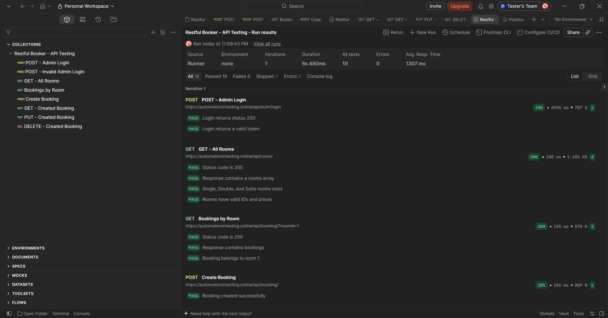
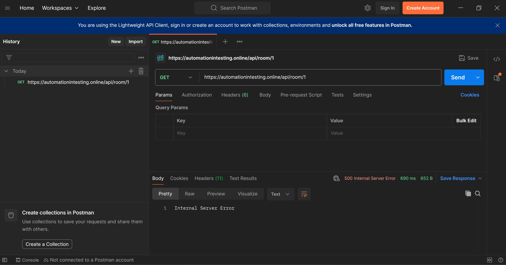
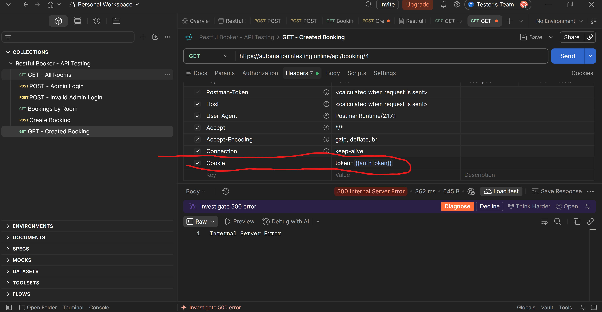
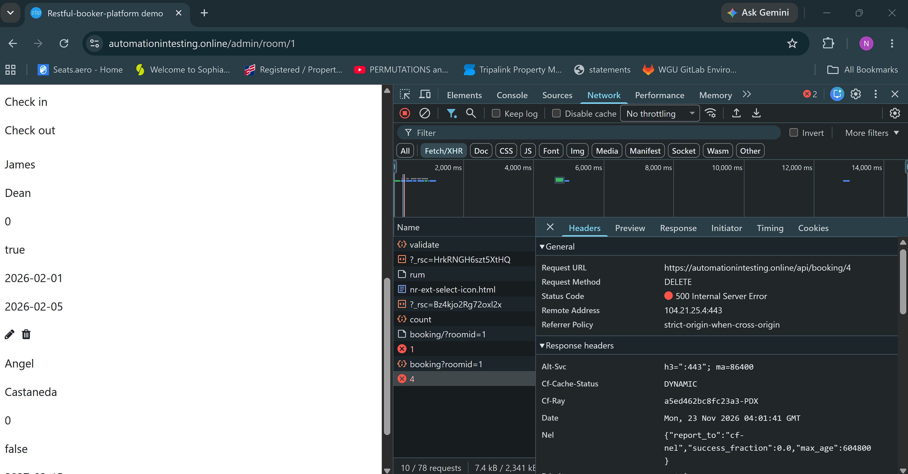

# Reservation Management System QA Portfolio

## Project Overview

This is an independent QA testing project I completed using the Restful Booker Platform, a public hotel reservation practice application.

I created this project to gain hands-on experience with the QA testing process, from understanding application functionality and creating test cases to executing tests, investigating issues, and documenting results.

I used manual testing, Postman for API testing, and Playwright with JavaScript for browser automation.

I selected the [Restful Booker Platform](https://automationintesting.online/) from [Automation in Testing](https://automationintesting.com/), an open-source practice application developed by Mark Winteringham for learning software testing and test automation.

I chose it because it provides both a working website and documented APIs, allowing me to practice manual testing, API testing, and browser automation against the same application.


**Application:** https://automationintesting.online/

## My Testing Approach

I started by exploring the application to understand how the room listings, reservation process, and administrator features worked.

Since this was an independent project, I developed my own proposed functional requirements and acceptance criteria based on the application's functionality. I then used those criteria and the published API documentation to create test scenarios and test cases.

Throughout the project, I completed the following:

1. Developed functional requirements, acceptance criteria, and 15 test cases.
2. Executed four manual test cases covering room navigation, room listings, and reservation functionality.
3. Tested eight API requests using Postman, including authentication, room retrieval, and reservation management.
4. Wrote JavaScript assertions to validate API responses and used collection variables to store authentication tokens and booking IDs.
5. Used Postman's Collection Runner to execute four API requests automatically, with 10 assertions passing.
6. Created three automated browser tests using Playwright and JavaScript.
7. Used Chrome DevTools and Postman to investigate failed requests and compare frontend behavior with API responses.
8. Documented four issues with reproduction steps, expected and actual results, and screenshots.
9. Configured and successfully ran a GitHub Actions workflow for my Playwright tests.

## Testing Results

| Test Type | Test Cases | Passed | Failed |
|---|---:|---:|---:|
| Manual Testing | 4 | 3 | 1 |
| Postman API Testing | 8 | 5 | 3 |
| Playwright Automation | 3 | 3 | 0 |
| **Total** | **15** | **11** | **4** |

## Manual Testing

I created four manual test cases covering booking navigation, room categories, Book Now buttons, and the Single room reservation interface.

Three test cases passed, and one failed because the reservation page remained stuck on a loading screen.

I also noticed that clicking Booking reached the correct section but did not position all the room content clearly on the screen. I recorded this as a usability observation rather than a confirmed defect.

**Manual testing evidence:**

[View screenshot: Booking navigation](screenshots/TC-001-booking-navigation.png)

[View Manual Test Cases](manual-testing/test-cases.md)

[View Test Execution Results](manual-testing/test-execution.md)

The reservation loading failure and its investigation are shown in BUG-001 below.

## API Testing with Postman

I used Postman to test eight API requests covering:

1. Valid administrator login
2. Invalid administrator login
3. Retrieving available rooms
4. Retrieving bookings by room ID
5. Creating a reservation
6. Retrieving an individual reservation
7. Updating an existing reservation
8. Deleting an existing reservation

Five requests produced the expected results. Three returned HTTP 500 errors when retrieving, updating, or deleting individual bookings.

I wrote JavaScript assertions to check HTTP status codes and response data. I also used collection variables to save authentication tokens and booking IDs for use in other requests.

### Postman Collection Runner

To practice automated API testing, I used Postman's Collection Runner to execute four selected requests in sequence:

1. POST Admin Login
2. GET All Rooms
3. GET Bookings by Room
4. POST Create Booking

**Result: 10 assertions passed, 0 failed.**

The three API requests that previously returned HTTP 500 were not included in this passing run. Their failures were investigated separately.

**Postman Collection Runner Results**



[View screenshot: Full Postman Collection Runner results](screenshots/API-collection-run-10-passed.png)

For anyone interested in reviewing the requests and JavaScript assertions, I also included the exported Postman collection.

[View Postman Collection JSON](api-testing/Restful%20Booker%20-%20API%20Testing.postman_collection.json)

## Playwright Browser Automation

I created three browser automation tests using Playwright and JavaScript.

The tests cover:

1. Successful administrator login using valid credentials
2. Invalid administrator login and error message validation
3. Verification that Single, Double, and Suite room categories are displayed

**Local execution result: 3 tests passed, 0 failed in Chromium.**

I also configured a GitHub Actions workflow to execute these tests automatically when changes are pushed to the repository or a pull request is created.

The workflow successfully completed after I published the project to GitHub.

**Automation evidence:**

[View Successful GitHub Actions Run](https://github.com/ProfessionalAngelC/Reservation-System-QA-Portfolio/actions/runs/45133466646)

[View Playwright Test Script](automation/tests/restful-booker.spec.js)

[View GitHub Actions Workflow](.github/workflows/playwright.yml)

## Bug Investigation

One of the most useful parts of this project was learning how to investigate failed functionality instead of only recording whether a test passed or failed.

I used Chrome DevTools to inspect network requests, HTTP status codes, and API responses. I also reproduced requests using Postman to compare the results with what I observed in the browser.

I documented four issues during testing.

### An Unexpected Finding

One thing that surprised me during this project was how many API requests returned errors, even though the API documentation described the functionality they were supposed to support.

Since this was a practice application specifically designed for software testing, I initially questioned whether I was making mistakes in my requests rather than assuming the application had defects.

To investigate further, I compared successful and failed API responses in Postman, checked authentication and booking information, and used Chrome DevTools to inspect the requests being made through the website itself.

For some operations, I was able to reproduce the same HTTP 500 errors through both Postman and the administrator interface. This gave me additional evidence that the failures were not limited to how I was sending requests in Postman.

I documented the findings in separate bug reports, although I couldn't determine the exact root causes.

This was one of the most valuable parts of the project because it taught me not to assume that an unexpected result is automatically an application defect. I learned to investigate the behavior, compare evidence, and document what I could actually verify.

### BUG-001: Reservation Pages Fail to Load

When I clicked Book Now for a room, the reservation interface remained stuck on a loading screen.

I investigated the issue using Chrome DevTools and found that the room detail API returned HTTP 500. I then tested the same endpoint in Postman, where I received the same server error.

The screenshots below show the problem in the browser and the corresponding API failure.

**Screenshot 1: Reservation page stuck loading**


**Screenshot 2: HTTP 500 response in Postman**



[View Full BUG-001 Report](bug-reports/BUG-001.md)

### BUG-002: Individual Booking Retrieval Returns HTTP 500

I was able to retrieve bookings using the room ID filter, but requesting an individual booking using its booking ID returned HTTP 500.

I compared the responses from both endpoints to document the difference in behavior.

**Screenshot: Failed individual booking request in Postman**



**Additional evidence:**

[View screenshot: Successful booking list request returning HTTP 200](screenshots/BUG-002-booking-list-200.png)

[View Full BUG-002 Report](bug-reports/BUG-002.md)

### BUG-003: Unable to Update an Existing Reservation

I attempted to update an existing reservation using a PUT request in Postman, but the API returned HTTP 500.

I also attempted the update through the administrator interface and inspected the network request using Chrome DevTools. The frontend operation produced the same server error.

**Screenshot: Failed PUT request in Chrome DevTools**


**Additional evidence:**

[View screenshot: Failed PUT request in Postman](screenshots/BUG-003-booking-put-500.png)

[View Full BUG-003 Report](bug-reports/BUG-003.md)

### BUG-004: Unable to Delete an Existing Reservation

I attempted to delete an existing reservation using Postman, but the DELETE request returned HTTP 500.

I reproduced the issue through the administrator interface and used Chrome DevTools to confirm that the request also failed there.

**Screenshot: Failed DELETE request in Chrome DevTools**



**Additional evidence:**

[View screenshot: Failed DELETE request in Postman](screenshots/BUG-004-postman-delete-500.png)

[View Full BUG-004 Report](bug-reports/BUG-004.md)

### Investigation Notes

These issues were observed while testing the public Restful Booker practice application.

I documented the steps to reproduce each issue, the expected and actual behavior, and the evidence collected during testing.

Although I reproduced several errors through both the browser and Postman, I did not confirm the underlying root causes.

## Tools Used

| Tool | How I Used It |
|---|---|
| Chrome DevTools | Inspected network requests, API responses, request methods, and HTTP errors |
| Postman | Tested API endpoints, wrote JavaScript assertions, used collection variables, and executed multiple requests with Collection Runner |
| Playwright | Automated browser testing using JavaScript |
| Visual Studio Code | Wrote test scripts and organized project documentation |
| GitHub | Published the project and tracked changes |
| GitHub Actions | Executed automated Playwright tests through a CI workflow |

## Project Documentation

| Document | Description |
|---|---|
| [Requirements and Acceptance Criteria](manual-testing/requirements-and-acceptance-criteria.md) | Functional requirements and acceptance criteria I developed independently |
| [Test Cases](manual-testing/test-cases.md) | 15 test cases covering manual, API, and automated browser testing |
| [Test Execution Results](manual-testing/test-execution.md) | Expected and actual results, pass or fail status, and related defects |
| [Bug Reports](bug-reports/) | Four documented issues with reproduction steps and supporting evidence |
| [Screenshots](screenshots/) | Screenshots from manual testing, Postman, and Chrome DevTools |
| [Postman Collection](api-testing/Restful%20Booker%20-%20API%20Testing.postman_collection.json) | Exported API requests and JavaScript assertions |
| [Playwright Tests](automation/tests/restful-booker.spec.js) | JavaScript browser automation tests |

## Running the Playwright Tests

The Playwright tests are located in the `automation` folder.

To run them locally, install Node.js and use the following commands:

```bash
cd automation
npm ci
npx playwright install chromium
npx playwright test restful-booker.spec.js --project=chromium
```

The tests run against the public Restful Booker Platform and do not require a local application server.

The Postman collection can also be imported into Postman using the JSON file in the `api-testing` folder.

## API Documentation

For API testing, I referenced the official Restful Booker Platform documentation to understand available endpoints, HTTP methods, request bodies, authentication requirements, and expected behavior.

[Restful Booker Platform API Documentation](https://www.postman.com/automation-in-testing/restful-booker-collections/documentation/ci13ds3/restful-booker-platform)

## Project Limitations

This project was completed independently using a public practice application.

The requirements and acceptance criteria were developed for portfolio purposes and were not provided by the application's development team.

The application periodically resets its data, so test results may differ between executions.

Some reservation operations returned HTTP 500 under the tested conditions, preventing successful completion of the full CRUD workflow.

The underlying causes of those failures were not confirmed.

## What I Learned

This project helped me better understand how requirements, acceptance criteria, test cases, execution results, automation, and bug reporting connect.

I gained hands-on experience designing test cases, testing APIs, writing basic browser automation scripts, and investigating unexpected application behavior.

One of the most useful parts was learning how to use Chrome DevTools and Postman together. Instead of only reporting that a feature did not work, I practiced gathering evidence that could help another tester or developer understand and reproduce the issue.

I also learned how to organize a QA project in GitHub and run automated browser tests through GitHub Actions.
