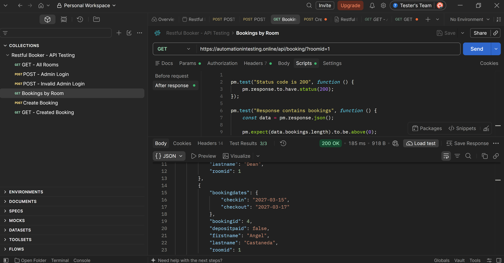
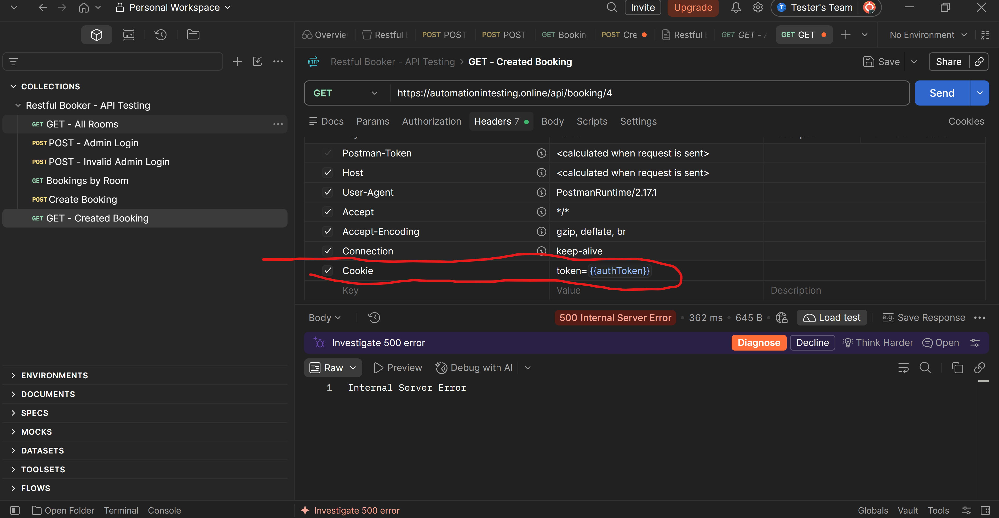

# BUG-002 — Individual Booking Retrieval Returns HTTP 500

**Related Test Case:** API Exploratory Testing  
**Requirement:** Booking Retrieval API (Documented Functionality)  
**Acceptance Criteria:** Existing reservations can be retrieved using their booking ID  
**Severity:** Medium  
**Suggested Priority:** Medium  
**Status:** Open — Portfolio Investigation  
**Environment:** Restful Booker Platform, Postman

## Description

The API returns HTTP 500 Internal Server Error when attempting to retrieve an existing reservation using its booking ID.

The reservation was successfully created and could be retrieved using the room-filtered endpoint, but retrieving the same reservation directly by its booking ID failed.

## Steps to Reproduce

1. Authenticate using `POST /api/auth/login`.
2. Create a reservation using `POST /api/booking/`.
3. Confirm that the API returns a booking ID.
4. Verify the reservation exists using `GET /api/booking/?roomid=1`.
5. Send `GET /api/booking/4` using a valid authentication token.
6. Observe the response.

## Expected Result

The API should return the reservation details associated with Booking ID 4.

## Actual Result

The API returned HTTP 500 Internal Server Error.

The same reservation was successfully retrieved using the room-filtered endpoint.

## API Investigation

The following requests were tested in Postman.

**Individual Booking Retrieval:**  
GET https://automationintesting.online/api/booking/4  
Status: 500 Internal Server Error  
Response: Internal Server Error

**Room-Filtered Booking Retrieval:**  
GET https://automationintesting.online/api/booking/?roomid=1  
Status: 200 OK

The room-filtered response included Booking ID 4 with the correct guest information, room ID, and reservation dates.

The individual booking request was also tested after refreshing the authentication token and continued returning HTTP 500.

Similar behavior was previously observed when retrieving Booking ID 1.

The underlying cause has not been confirmed.

## Business Impact

The individual booking endpoint cannot retrieve existing reservations under the tested conditions. Applications relying on this endpoint may be unable to display individual reservation details.

The room-filtered endpoint remains functional.

## Evidence

Successful room-filtered retrieval:

Failed individual booking retrieval:

## Notes

This issue was identified during independent testing of a public practice application. It has not been submitted to the application's development team.

Severity and priority are suggested assessments. The cause of the failure has not been determined.