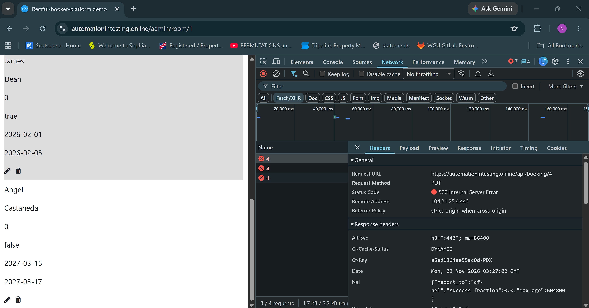

# BUG-003 — Unable to Update Existing Reservation

**Related Test Case:** API-007
**Requirement:** REQ-006
**Acceptance Criteria:** AC-017
**Severity:** Medium  
**Suggested Priority:** Medium  
**Status:** Open — Portfolio Investigation  
**Environment:** Restful Booker Platform, Google Chrome, Postman

## Description

The application returns HTTP 500 Internal Server Error when attempting to update an existing reservation.

The issue was first observed in Postman and later reproduced through the website's Admin interface.

## Steps to Reproduce

1. Open https://automationintesting.online/ and log in as an administrator.
2. Navigate to Rooms and select Room 1.
3. Locate an existing reservation.
4. Click the pencil icon to edit the reservation.
5. Change the guest's first name.
6. Click the checkmark to save the changes.
7. Observe the result and inspect the request using Chrome DevTools.

## Expected Result

The reservation should update successfully and display the modified guest information.

## Actual Result

The reservation failed to update, and the application returned HTTP 500 Internal Server Error.

The original guest information remained unchanged.

## API Investigation

The reservation was first updated through Postman using the following endpoint:

**Request:** PUT https://automationintesting.online/api/booking/4  
**Status:** 500 Internal Server Error  
**Response:** Internal Server Error

The request included the updated guest information, room ID, deposit status, reservation dates, and authentication token.

The existence of Booking ID 4 was confirmed using the room-filtered GET endpoint.

### Frontend Verification

The update was also attempted through the website's Admin interface.

Chrome DevTools captured the following request:

**Request:** PUT https://automationintesting.online/api/booking/4  
**Status:** 500 Internal Server Error

The frontend request included the booking ID and reservation details.

The issue was reproduced when attempting to change the guest's first name from "Angel" to "not Angel".

The application continued displaying the original guest information.

The underlying cause has not been confirmed.

## Business Impact

Administrators cannot save changes to existing reservations under the tested conditions. This may prevent corrections to guest information and other reservation details.

## Evidence

Failed frontend update captured using Chrome DevTools:

The same HTTP 500 response was also observed independently in Postman.

## Notes

This issue was identified during independent testing of a public practice application. It has not been submitted to the application's development team.

Severity and priority are suggested assessments. The cause of the failure has not been determined.
