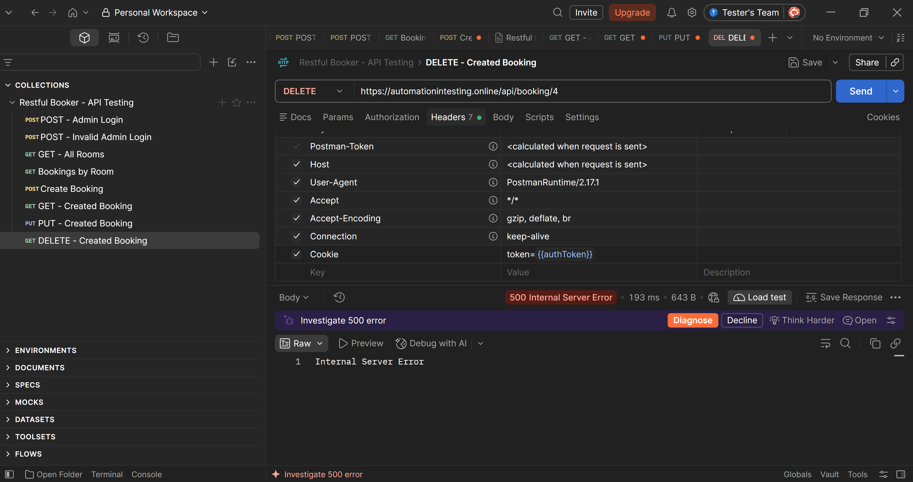
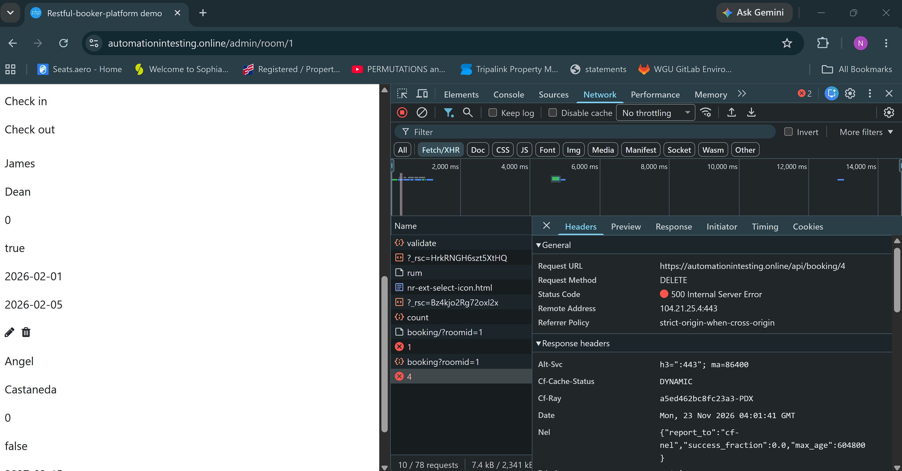

# BUG-004 — Unable to Delete Existing Reservation

**Related Test Case:** API and Frontend Exploratory Testing  
**Requirement:** Booking Deletion API (Documented Functionality)  
**Acceptance Criteria:** Existing reservations can be deleted using their booking ID (proposed expected behavior)  
**Severity:** Medium  
**Suggested Priority:** Medium  
**Status:** Open — Portfolio Investigation  
**Environment:** Restful Booker Platform, Google Chrome, Postman

## Description

The application returns HTTP 500 Internal Server Error when attempting to delete an existing reservation.

The issue was first observed in Postman and later reproduced through the website's Admin interface. In both cases, the reservation deletion failed.

## Steps to Reproduce

1. Open https://automationintesting.online/ and log in as an administrator.
2. Navigate to Rooms and select Room 1.
3. Locate an existing reservation (Booking ID 4 was used during testing).
4. Click the trash icon next to the reservation.
5. Observe the result and inspect the request using Chrome DevTools.

## Expected Result

The reservation should be deleted successfully and should no longer appear in the room's reservation list.

## Actual Result

The application returned HTTP 500 Internal Server Error.

The reservation remained visible in the Admin interface after the deletion attempt.

## API Investigation

The reservation was first deleted through Postman using the following endpoint:

**Request:** DELETE https://automationintesting.online/api/booking/4  
**Status:** 500 Internal Server Error  
**Response:** Internal Server Error

The request included an authentication token.

### Frontend Verification

The deletion was also attempted through the website's Admin interface.

Chrome DevTools captured the following request:

**Request:** DELETE https://automationintesting.online/api/booking/4  
**Status:** 500 Internal Server Error

The reservation remained displayed after the failed request.

The same error was observed through both Postman and the frontend. The underlying cause has not been confirmed.

## Business Impact

Administrators cannot delete reservations through the tested functionality. This may prevent staff from removing incorrect or unwanted bookings.

## Evidence

Postman DELETE request returning HTTP 500:

Failed reservation deletion captured using Chrome DevTools:

## Notes

This issue was identified during independent testing of a public practice application. It has not been submitted to the application's development team.

Severity and priority are suggested assessments. The cause of the failure has not been determined.